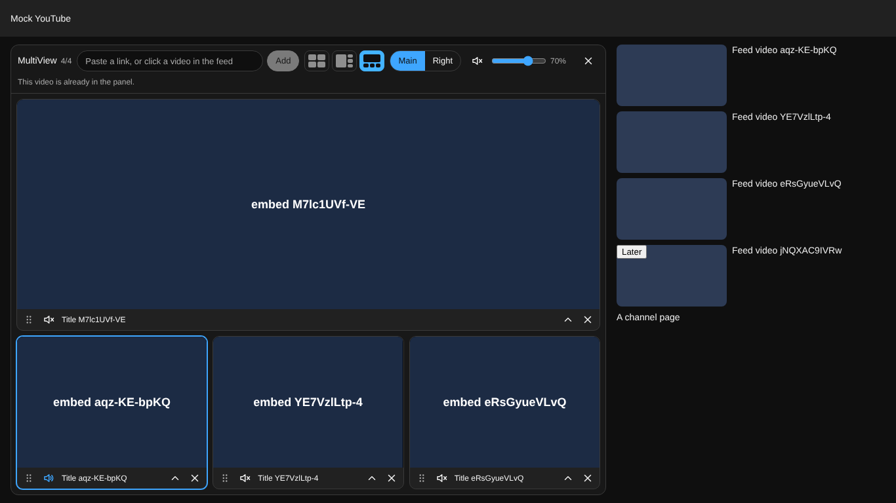

# yt-adhd-premium

Four YouTube videos at once, right inside YouTube, with one sound. I wanted to keep scrolling the feed with a stream and a lecture running next to it (yes, the name is honest).

In the browser it shows up as **ADHD MultiView**. Made with Claude Cowork and Claude Code.

> Works with YouTube. Not affiliated with, endorsed or sponsored by YouTube or Google.



<sub>Offline test page, so the players are placeholders.</sub>

## What you get

- The panel sits where the YouTube player and comments were. The feed on the right keeps scrolling.
- Click a video in the feed and it lands in the panel. Ctrl+click and the middle button still open a tab.
- 1 to 4 windows, 11 layouts in the Windows snap spirit. Drag a window by its ⠿ handle onto another one to swap them.
- One sound at a time. Add a video while another one plays and a small prompt asks which sound stays. The players' own mute buttons count too: unmute a window there and it becomes the sound.
- The ▴ under a window opens its title and channel. That video shrinks a bit to make room.
- **Right** moves the windows into the recommendations column and gives the YouTube player back. It becomes one more sound source.
- On the home page or in search the panel floats in the top right corner.
- The video you were watching carries on in the panel from the same second.

## Install

No store, takes a couple of minutes.

1. **Code → Download ZIP**, unpack it somewhere you won't move. Or clone.
2. Open `edge://extensions` (or `chrome://extensions`), turn on **Developer mode**, click **Load unpacked**, pick the `extension` folder.
3. Pin **ADHD MultiView**, open YouTube, click it. Click again to close.

After an update: **Reload** on the extensions page, then reload the YouTube tab.

## Permissions

| Permission | What for |
|---|---|
| `activeTab`, `scripting` | Puts the panel into the YouTube tab after your click. |
| `storage` | Remembers your videos, layouts, position and volume in this browser. |
| `declarativeNetRequestWithHostAccess` + `youtube.com`, `youtube-nocookie.com` | Tells YouTube's embedded player who is asking. |

YouTube wants every embedded player to say who embeds it, through the `Referer` header ([client identity rules](https://developers.google.com/youtube/terms/required-minimum-functionality#embedded-player-api-client-identity)). Inside youtube.com the embeds would say "youtube.com" and fail with error 152. So while the panel is open, a session rule sends `https://adhd-multiview.<extension-id>/` for the extension's own embeds in that tab, and drops the rule when you close the panel or leave. The `key` in the manifest keeps the ID stable.

No server, no analytics. Videos come from `youtube-nocookie.com` through the official `iframe_api` script.

## YouTube's rules

Every window is YouTube's own embedded player with its controls and branding, at least 200×200 px, with nothing drawn on top of it. Only one window starts by itself at a time, restored sets never autoplay, sound goes through the documented `mute()` / `unMute()` / `setVolume()` calls, and the players' own controls keep working. Closing the panel removes every player.

One gap I know about: with the panel open, the extension reshapes youtube.com (hides the player and comments, or the recommendations) and turns feed clicks into "add". YouTube's [Developer Policies](https://developers.google.com/youtube/terms/developer-policies) ask API clients to leave YouTube's own interface alone without approval. So this is a personal tool, and it is not in any extension store. Not legal advice.

## Limits

- Four videos max. RAM and bandwidth will notice.
- Owners can switch embedding off; private, age-restricted and region-locked videos may refuse to play in a window.
- YouTube changes its markup often. If the panel lands somewhere weird, open an issue.

## Dev

No build step, no runtime dependencies.

```text
npm test          # unit tests, Node 20+
npm run check     # manifest, permissions, syntax, icons
npm run e2e       # real extension in Chromium against a local mock of YouTube (Playwright, openssl, port 443)
npm run package   # ZIP for manual install
```

`extension/background.js` toolbar button and network rule · `content.js` the panel · `page-bridge.js` YouTube IFrame API in the page · `core.js` links, layouts, audio switching.

## License

MIT
